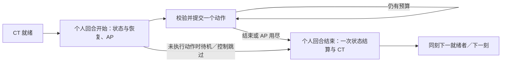

# 统一行动力与多次行动的规则及迁移设计

日期：2026-10-05 · 来源任务：D-COMBAT-AP-01 · 核对基线：`dcb8372e286772bfb45dcf731d94dc3c90aa9f02`

**交付状态：2026-10-05 负责人已批准本方案；费用尚待数值验证，运行时尚未实施。** 本文是后续规则迁移与实现规划的已批准规格，现行 L2 与运行时仍待迁移，不代表统一行动力已上线。证据、契约核对与验证结果见 `开发管理/统一行动力设计核对记录.txt`。

批准依据：负责人在本会话明确回复“方案批准了”，批准对象为提交 `a290e780f7fa55c72ad884c96da26397d9d47f12` 中的本方案。批准采用正文推荐规则，包括 §11 原待批准的新语义；正文未定案的具体费用、养成预算和逐项迁移映射仍须后续核定与验证。完整实现任务图尚待独立规划。

## 1. 已确认需求与设计边界

任务卡记录的用户要求是：轮到角色时以 **100 基础行动力（AP）** 为设计基准；移动按位移速度换算每单位距离的 AP；普攻、术法、神通、防御、道具等使用各自成本；留出独立养成维度和流派空间。用户明确允许同一个人回合多次攻击／施法，仍需满足 AP、灵力、冷却、范围、资格和状态等合法性。不得恢复通用的“每回合最多攻击／施法一次”。

100 是基础预算方向，不是已经验证的最终成本表。保留 CTB、`100/v`、剩余 AP 不结转、惩罚累加、状态时点和返还规则已随本方案整体获批；该批准不构成生产费用或角色强度已经平衡的证据。

本轮只交规则和迁移方案；不改 L2、CSV、Unity、BattleSim、存档或自动化，不生产新功法、术法、神通、装备。实现卡只在规格批准后，通过一次独立规划建立完整已知任务图。

## 2. 当前事实与报告的可信边界

| 对象 | 基线源码／原文事实 | 对新方案的约束 |
|---|---|---|
| CTB | `战斗系统.txt#第一章` 规定每整数刻全员 CT 加反应、就绪队列、行动后清零、下一门槛 100＋冷却惩罚；Unity `CTBEngine` 基本采用此流程 | AP 不能默默取代 CT；多动作必须只结算一次个人回合 |
| 旧行动阶段 | `CombatSession.BeginTurn/RecordAction/ValidateCommand`：移动不改阶段；非移动动作后转 `ActionThenMove`，再攻击／施法被拒绝；`RecordAction` 覆盖惩罚 | 废除旧阶段对动作次数的限制，不能把覆盖写入直接用于多次施法 |
| 移动 | `CombatantSnapshot.ResetMovePoints/CommitMovement` 使用独立移力；`CombatEntryAdapter.SpatialCombatQuery` 将定点路径费用按整距离向上取整 | 改为同一 AP 预算；必须保留原始路径单位，不能先按每条移动命令取整 |
| 反应与位移 | L2 将反应定义为行动轴速度、移力定义为单次可移距离；BattleSim `Character` 的移力来自境界基表；Unity `AdventureUnitSpawner.CreatePlayer/CreateEnemy` 却由反应／20 四舍五入并夹在 2～8 生成移力 | 当前两个运行时没有共用独立位移属性，不能宣称已支持独立移动养成 |
| 冷却 | Unity `CombatActionResolver.ResolveAttack` 设置技能 tick 冷却，同时 `CombatCommandService` 把同一 `CooldownTicks` 用作 CT 门槛惩罚 | 两种单位必须显式分离；保留原有技能合法性，不能以新增 AP 为由取消冷却 |
| BattleSim | 1v1 使用 next-time 与单次选招，双方冷却在每次全场行动前递减；2v2 每次选一人前全员充能、选最高 CT、扣 100 留溢出 | 两者都不能直接证明新 AP 与 Unity 一致；须迁移两个入口 |
| 防御／恢复 | L2 防御姿态写防御×1.5；内核实际对最终伤害×0.5，且所查回合入口没有清除 `IsGuarding`。L2 每回合恢复未区分个人回合；Unity 回合入口未接入通用自动恢复 | 本稿新时点及防御公式已获批准；实现差异仍待迁移验证 |
| 命令覆盖 | 内核有普攻、术法、神通、防御、待机、移动、换术、结束；`CombatActionKind` 的正式预览列表没有换术；没有战斗道具／换装备命令 | 道具／换装列为缺失能力，换术区分内核和正式 UI，不冒称已经可玩 |

用户报告“先位移不能用其他行为，先其他行为却可以位移”**尚未复现、根因未确认**。现有 EditMode 用例明确断言移力用尽仍可攻击；PlayMode 移动用例在演出期间拒绝输入，演出结束后成功防御。`EncounterCoordinator.ExecutePlayer/Present` 和 `CombatCommandInput` 是输入权威与消费链；`AdventureSceneInstaller` 注入的 `Static3DCombatUnitPresentationProvider.IsPresenting` 聚合移动、动作恢复和临时反馈。上述事实只给出排查入口，不能证明用户问题就是演出锁。

可确认的运行版本仅为本工作树基线。未取得用户启动的 Editor／构建 commit、复现步骤或现场日志；源码中的 `MovementCellsPerSecond=4` 是表现速度，不能拿来换算 AP 的规则位移速度。

## 3. 方案比较与建议方向

| 方案 | 收益 | 代价／判断 |
|---|---|---|
| **保留 CTB，个人回合内统一 AP（推荐）** | 反应决定轮到谁，AP 决定本回合能做多少；能直接支持穿插与多动作 | 需清理旧阶段、区分冷却、统一回合事件；职责最清楚 |
| 用 AP 同时推进全局轴 | 每次动作都可产生时间延迟 | 会改变队列、敌我插入和状态时钟；不是本次最小迁移 |
| 独立移力加多次动作额度 | 改动表面较少 | 仍有两套预算，无法满足统一行动力与移动成本目标，不采用 |

以下章节的推荐规则已获负责人批准；后续须完成一次独立规划，冻结完整任务图、字面量路径和验收入口后，才将满足前置的实现叶子设为 ready。

## 4. 三个时间单位与个人回合生命周期（建议）

- **一次动作**：一次通过权威校验并提交的战斗命令，可含若干效果／目标。多目标不算多次付费动作；预览、取消、被拒绝命令不算动作。移动命令是一段完整合法路径。
- **个人行动回合**：角色因 CT 就绪被选中，到主动结束、预算耗尽、跳过或战斗终结的一次控制权。只生成一次开始和结束事件；继续操作／重复刷新快照不重新开始。
- **tick（刻）**：全局整数时间。未结束的个人回合内，移动、施法、演出及等待玩家输入不推进刻；同刻的就绪队列先处理完，再充下一刻。

建议事件顺序如下，按现有状态原型声明操作，不新建状态分类或额外调度器：

1. 选中活角色后，清除上一个人回合的普通防御姿态；执行声明在本人回合开始的状态效果、持续伤害、控制和到期处理。死亡／战斗结束立即走终结，不恢复或复活。
2. 仍存活者自动生命／灵力恢复一次并截断到上限，随后快照本回合 AP 上限；位移效率在每次移动报价与提交时核对当前有效值。反应不参与 AP 发放。跳过行动的控制回合仍计一次本人回合及恢复；跳过者 AP 为 0，直接正常结束，不能用待机获取 CT 保留。
3. 可行动者发放 AP。每个成功命令只结算其动作／命中／受击等事件，不重做恢复、回合持续时间或每回合额度。失败不改变这些事件计数。
4. 结束时执行本人回合结束原型效果、持续时长及每回合计数，清空剩余 AP，结算 CT 一次。战斗终结清除会话临时预算／姿态，结果提交及资源写回仍走现有结果所有者。

“持续 N 回合”建议统一为**受影响角色的后续个人回合结束次数**：在本人当前回合施加时，当前结束不递减；下一次本人回合结束才第一次减 1。在他人回合施加时，目标下一次本人回合结束第一次递减。持续 tick 的原型仍只随全局刻推进。持续次数与触发额度分别声明，不能由多次移动／攻击加速耗尽或延长。

每次攻击／命中／受击可按原型多次触发；“每回合一次”按个人回合只允许一次，不随换术、换装、改目标或预览重置。旧 `AdvanceActionState` 的守一／符胆与雷劫等每次出手效果须逐条对照 L2 归类，不能把旧“单行动等于一回合”自动扩成多倍叠层或返还。眩晕阻止整回合、定身只阻止自愿移动、封灵阻止对应施法；AP 充足不绕过它们。

## 5. AP 获得、上限与结束（建议）

定义固定基准 `AP_ref=100`；基础角色 `AP_max=100`，合法养成增量可提高 `AP_max`。个人回合开始 `AP_remaining=AP_max`，不存在独立“移力余额”。剩余 AP 不跨回合累计，不转换成灵力或 CT。

本回合 AP 上限和初始发放在开始时快照；途中换装或获得永久上限成长于下一个人回合生效，不立即发放差额，也不能靠反复换装补满。明确声明的临时 AP 效果仅按其有限预算结算，当前余额不能超过本回合快照上限。

**结束行动**：任何可行动的当前角色均可选择，即使本回合尚未花 AP；费用为 0，只放弃余额。正常结束后 CT 清零、下一门槛按累计惩罚结算。成功动作后 AP 恰为 0 自动走同一个正常结束入口；AP 尚有零头却没有合法付费动作时仍可显式结束。取消或拒绝命令不自动结束。

**普通待机**：只有本个人回合没有提交任何有战斗收益的动作时可选，结束后保留当前 CT 的 50%、下一门槛恢复 100、无新惩罚。预览／取消不影响资格；已经移动、施法、防御、道具、换装／换术或合法免费主动收益后不能待机，必须正常结束。这样不沿用旧“先移动再待机仍保留一半 CT”的收益，也不能用待机洗掉施法惩罚。该收紧已随方案获批。

## 6. 移动成本与位移成长（建议）

位移速度 `v` 的规则单位是“**100 基准 AP 可支付的普通等效距离**”，不是米／秒、动画帧／秒或每刻 CT。普通单位长度 1 对应现有空间服务的一标准距离；旧 L2 移力 M 在无空间变化、无额外地形负担时映射为 `v=M`。全用 100 AP 移动可走约 M 距离，同时放弃动作预算。

AP 理想移动成本：`C_move = AP_ref × D_move / v`。`D_move` 来自**同一权威合法路径**，逐边累加 `metricDistance` 与移动专用负担；禁止改用屏幕位移、格子计数或欧氏距离。占位、高度、有向边、实体障碍、移动形态先决定可走性；AP 不能买通非法边。距离查询仍是原空间度量，移动 AP 定价不改变攻击射程。

移动预览和提交读取同一合法路径及原始定点边费。建议 AP 精度 `S=1000`（1 AP＝1000 最小单位；这是精度候选，不是平衡费用），空间尺度 `K=UnitsPerRange`，正位移速度用同一空间定点值 `v_u=K×v`。每条边原始移动费 `d_e` 已含边长和移动负担，定义：

`edgeAP_u = max(1, floor(100 × S × d_e / v_u))`；`pathAP_u = Σ edgeAP_u`。

使用有溢出检查的整数运算，每个正费合法边至少 1 最小单位，**只在边上定价，不在每条移动命令末尾再次取整**。选择边费向下取整并保留正最小单位，避免v=3时三条普通边因各向上取整至33.334而需要100.002 AP、实际只能走两条的预算边界问题；当前候选每边33.333，三边99.999。同一条实际路线、同一速度和负担，拆成多段或一次移动费用完全一致；中间插入施法也不重置舍入。若实际路线、速度或环境发生变化，按各自提交时的新事实收费，不能回溯退还已走路径。

复用现有空间查询所有者及寻路，不另造 AP 地图；扩展其预算／结果精度，使可达性、最小 AP 路径、选中路径和确认费用使用相同边费。不能在 `CombatEntryAdapter` 先执行现有 `(cost+K-1)/K` 再换 AP，否则分段误差已经丢失。每条边相对理想费的误差绝对值小于1/S AP，总误差小于“边数／S AP”；极短压缩边的正最小费、长路和可达边界需后续验证，不以浮点近似通过。

`v=0` 表示不能自愿移动，不作除法或强制夹成 1；负值／非法精度属于数据错误。强制位移不是目标的自主移动，不扣目标 AP；瞬移／移动术法付该动作声明费用，只有内容明确声明额外自主移动段时才追加路径费，避免双扣。

增加 AP 上限时，分子始终为 **100**，不能改成 `AP_max`。例如纯算术夹具：`v=5` 时普通距离 1 费 20 AP；AP 上限从 100 增到 120 后同距离仍费 20，可走 6 距离。位移效率提高则单独降低每边费用；反应只改变获得个人回合的频率。这些例子不是生产参数或平衡结论。

Unity 现有反应生成移力只作为迁移基线证据。建议一次性提供独立位移效率数据／养成字段并对玩家、NPC 明确赋值，不继续隐藏地从反应派生；初始投影如何映射须在数据合同批准时逐项定案，不能自动把两运行时不同的 M 合并成已批准数值。

## 7. 统一成本、冷却与提交边界（建议）

### 7.1 一个成本合同

继续由现有命令校验／执行所有者生产同一费用报价，不引入第二执行器。报价至少包含动作／目标／路径与上下文版本、AP 费用、灵力／物品等其他资源费用、CT 惩罚、技能独立冷却、合法性及拒绝原因。AP 与 MP 同时满足才可执行，不能互相抵扣。

生产者建议字段：动作 `actionPointCost`、`ctPenalty`、`reuseCooldownTicks`；角色 `actionPointMaximum`、独立位移效率及有界成本修正。名称和单位在后续公共数据合同中冻结。`AttackProfiles.csv` 已是攻击参数唯一生产者；不得给既有攻击另建第二张可编辑成本表。防御、道具、换术／换装的成本进其现有或待建行为定义，均消费同一报价合同。

| 行为 | AP 合同及其他约束 | 首批覆盖／现状 |
|---|---|---|
| 普攻 | 独立正 AP 费用；保留武器／无装备档案、射程和原有独立冷却 | `basic_unarmed`，可在 AP 足够且冷却为 0 时连续使用 |
| 术法 | 每个 profile 独立 AP；保留目标差异 MP、资格、装配、范围与冷却 | `spell_guanshiji`、`spell_julingshu`；聚灵自用／对他用 MP 差异保留 |
| 主动神通 | 显式 AP 和既有额外费用；不由“无 MP”推导 AP 免费 | 内核支持 Divine，当前 AttackProfiles 生产表没有 Divine 行；不新造样例 |
| 被动／条件触发神通 | 不是任意可重复点击命令；按原型条件与唯一账本结算 | 不为每条被动事件重复扣主动 AP；共享 `abilityInstanceId` 不复制额度／冷却 |
| 防御 | 独立正 AP 费用，不自动结束；姿态规则见 §8 | 已有 Guard，费用尚无 AP 字段 |
| 道具 | 明确单项 AP＋库存／次数＋目标；一次命令原子扣库存 | L2 有行为概念，当前内核／正式 UI 无此命令，必须独立补齐 |
| 换装备 | 明确 AP、槽位与可装配资格；当前回合上限不重发 | L2 有行为概念，当前内核／正式 UI 无此命令 |
| 换术 | 明确 AP；保留现有每战更换次数、候选资格和换入冷却 | 内核 `SwapSpell` 已有，默认每战上限 2、换入 60 tick；正式预览／动作条未接入 |
| 结束／待机 | 0 AP 的终结命令；不同 CT 结果与资格 | 明确分别显示，不能再用 `CanEndTurn` 表示其他行为已经不能使用 |

首批迁移要将三条现有生产攻击、玩家／石甲兽移动、防御、换术及结束／待机完整纳入 AP。其他既有术法／神通定义须清查承载字段及使用入口；道具／换装属于新增缺失命令工作包，未完成时整项“各行为统一 AP”验收不能宣称关闭。

**费用候选边界**：所有有收益的主动付费行为均有正的最小净 AP 成本；每动作具体费用、减耗下限、返还总预算不在本卡定案。为验证多动作可达性，应有“100 AP 内可连续两次合法普攻／不同术法”的夹具，生产费用仍须实跑。不能将每种动作定价≥100后声称满足多次行动目标。

**血脉规则调整已批准**：现行 `神通设计规范.txt#血脉神通是身份标签` 明确不消耗灵力／行动权，与所有主动神通统一正 AP 费用存在交叉。本次批准采用推荐路线：玩家主动释放声明 AP，被动／自动触发保留天生免费；不因此新增灵力消耗，也不添加通用一次攻击上限。后续 W1 同步 L2，具体 AP 费用仍待数值验证；当前 L2 与运行时尚未改动。

### 7.2 CT 惩罚与技能重用分开

建议每个成功动作的非负 `ctPenalty` 累加为 `P_turn`，正常个人回合结束一次设置 `CT=0`、`nextThreshold=100+P_turn`。移动和没有声明惩罚的行为加 0。拒绝／取消不加；已经合法出手但未命中仍付费并加惩罚。所有失败原因不得让先前已成功动作的惩罚消失。

相加比“最后一次覆盖”或“只取最大”更能保留多次大术法的时间代价：纯语义夹具惩罚 10、30 的两个动作，任意顺序结束都是 140 门槛；随后普攻惩罚 0 仍是 140。取最大只收费 30，允许额外大招不增加轴代价；旧覆盖还允许最后一个普通动作抹掉全部惩罚。具体费用与 CT 叠加是否过重留给实跑。

建议保留已接入 Unity 技能的**全局整数 tick 重用冷却**：成功施放设置该能力的 `reuseCooldownTicks`，只随全局刻推进递减，不能靠本回合多次出手／移动／动画结束减少。冷却为 0 且其他条件满足的同一技能可重复；冷却为正的同技能本回合仍不可重用；不同技能各查自身账本。这保留已有合法性，不添加通用施法次数限制。

旧 `cooldownTicks` 在生产 Unity 中已承担两个职责。建议三条现有 profile 先显式投影原轴惩罚与原 tick 重用值，保留当前已接入语义，再由专门数值包决定是否调整，不能直接删掉按钮冷却。BattleSim 旧“回合数”没有通用乘 10 或照抄到 tick 的依据，必须逐 ID／账本列明旧单位、迁移依据和批准新值。金丹共享能力实例的资源／冷却仍保持一份账本，不因两个外显 profile 重置。

整数刻预览必须向上取整：反应 50、下一门槛 130 时是 3 刻，180 时是 4 刻；旧 L2 示例 2.6／3.6 刻只能理解为连续等效时长，需在规则迁移时修正实际展示口径。不得以次序相同证明时间量纲已经一致。

### 7.3 失败不扣费与原子提交

预览纯读取、不取随机数、不扣资源。确认时重查 actor／回合／上下文、能力授权／冷却／控制、路径／目标、AP、MP／库存；事实变化则拒绝且保持 AP、MP、库存、位置、冷却、惩罚和每回合额度不变。费用足够且行为合法后，在同一次权威提交中扣完整费用、记录动作、启动冷却并施加结果；预览与提交必须同源。

取消、失效预览、非法格／范围、资源不足、重复提交不扣；攻击未命中是已执行结果，照常扣 AP／MP、启动冷却、计 CT 惩罚。治疗／聚灵目标已满但动作仍合法时沿用现有执行成本，不把无收益结果当取消。若效果提交本身不能完成，必须保证命令整体未提交；不能先扣费再用兜底吞掉失败。演出在规则提交后播放，输入忙碌只防重入，不改回合与费用。

## 8. 防御与养成边界（建议）

普通防御姿态成功激活后持续到下一个人回合开始；保留 L2 的肉防／魂防×1.5方向，由后续功能与数值验证确认，不能把当前最终伤害×0.5说成等价实现。再次激活同一姿态无效且不扣费，不叠加倍率／持续时间；下一次成功自愿移动、攻击／施法、道具、换术／换装先退出防御，再结算该动作。失败／取消不退出；结束行动保留防御覆盖敌方行动，死亡／离场退出。其他技能状态各按自己的合并规则，不套普通 Guard。

| 养成维度 | 提供的流派空间 | 互斥／预算约束 |
|---|---|---|
| AP 上限 | 一回合更多操作／爆发组合 | 与移动分子 100 分开；回合中上限变化不发钱 |
| 位移效率 v | 机动／游击 | 与反应分离；同来源效果不能又提高 v 又重复给同一移动折扣，除非明确共用成长预算 |
| 特定动作减耗 | 体修普攻、术法专精、器修操作等方向 | 只匹配声明类别／实例；同一来源按唯一实例计一次；不从 MP 减耗自动推导 AP 减耗 |
| 条件 AP 返还 | 命中、特定组合、有限节奏奖励 | 有根动作、触发条件、本人回合次数和总量上限；不靠改目标／换装刷新 |
| CT／冷却修正 | 快节奏与重术法取舍 | 分别修改对应量纲，不把 AP、CT、技能 CD 一起无预算降低 |

建议修正顺序固定为“基础费用 → 合法固定减耗 → 合法比例减耗 → 最小成本夹限 → 最小单位向上取整”，同类来源先按已有互斥／叠加合同聚合，缺合同不随意叠乘。下限须为正；具体值是待验证参数，不能在本卡宣布已平衡。

普通路径移动的效率修正统一并入v，在每条边上定价；不按移动命令的段数发放固定减耗或返还。这样把同一路线拆成多次点击不能多领优惠，移动前后插入其他动作也不重置移动定价。上述动作级减耗／返还先用于有明确独立动作定义的其他行为。

返还只在一个根动作成功结算后计算一次，满足：`R ≤ min(声明返还, 本回合剩余返还预算, 本次实付AP−最小净费, AP上限−当前余额)`。超额截断，不结转；返还本身不触发返还，不能以返还、免费自动事件或派生效果充当新的付费根动作。由此每个可重复有收益主动动作都有正净支出，有限 AP 下不能无限循环。每回合返还预算与次数是成长预算的一部分，尚待实跑；主动血脉按 §7 已批准的 AP 路线迁移，被动／自动触发保留免费。

纯显示、选目标、预览及无收益朝向调整可免费，但不能恢复 AP、推进冷却或触发付费动作奖励。控制状态仍先校验；返还不能令跳过／禁用动作重新合法。首次实现仅承载批准的参数与有限触发，不顺带填满整条养成内容。

## 9. 数据、导入与存档迁移（建议）

攻击成本沿 `docs` 对应规则／内容 → `AttackProfiles.csv` → `CombatContentImporter` → `AttackProfileData` → `CombatEntryAdapter`／BattleSim 只读投影传递；`Spells.csv`、`Skills.csv` 及其 Spell／Divine 投影按现行分工同步，不让它们成为攻击成本第二生产者。严格导入在写 asset 前拒绝缺成本、负费用、错误单位、未知行为／能力引用和不可终止的免费主动配置。生成／新增 Unity 文件包含对应 `.meta`；更新事实源时同步相关 L1 指针。

角色长期成长沿现有 Character 定义／runtime snapshot／progression 或 modifiers 的适当所有者传递；当前 `CharacterRecord` 没有独立 AP／位移成长字段。保存的是合法长期成长输入或可重建来源，不保存派生 AP 余额、回合惩罚或移动预览。本方案不新增战斗中途存档：现有 `GameSaveEnvelope` 的长期资源／装配链继续负责结果保存。

实际源码 `GameSaveSerializer.SchemaVersion=3`，与旧状态摘要的 schema 2 不一致；新保存决策以源码为准。只有确实增加长期字段且无法由既有来源重建时才版本化保存合同，先核查现有恢复验证再决定迁移；不能把旧档缺字段一律夹成 100／旧反应派生值，或删除存档解决语义缺失。旧 schema 1／2 有角色档的现行拒绝边界继续有效。本卡不选定新 schema 号，也不改变存档删除任务。

## 10. 已知迁移工作包、职责与依赖

以下 W 标签保留为方案工作包；2026-10-05 已在独立规划中建立汇总父项 `P-COMBAT-AP-01` 与全部 19 张已知叶子卡，W→任务 ID 映射、依赖和首批 ready 见 `开发管理/统一行动力实现规划.txt`。每叶的执行事实以对应活跃任务卡为准，父项仅汇总、不再领取或逐轮拆分。代码叶子由冻结合同内的 DeepSeek 实施、Codex 独立复审；公共语义／规划由 Codex 负责，不由辅助意见签收。

| 包 | 单独可判断结果与所有者 | 预计工作面／验收入口 | 依赖 |
|---|---|---|---|
| W0 规格批准与完整规划 | 负责人已批准新增语义；完整任务图已建立，后续仅按各叶子前置准备执行 | 本文 §11、任务管理；所有费用标记待测，不先改 runtime | 本设计交付 |
| W1 L2 规则迁移 | Codex 设计主责；AP、三时钟、状态／防御、神通例外一致 | 战斗系统、角色属性、空间／状态规则、术法／神通规范及对应 L1；逐条语义核对 | W0 |
| W2 公共合同／数据 schema | Codex 冻结单位、费用与长期成长边界 | AttackProfiles、角色成长、GameplayContracts、存档合同；生产者／消费者覆盖、非法输入矩阵 | W0、W1 |
| W3 数据及严格导入 | Content／Editor 所有者，DeepSeek＋Codex 复审 | CSV、AttackProfile／Spell／Divine／Character 数据、CombatContentImporter、相关 asset／meta；导入前整表校验与数据链 | W2 |
| W4 长期角色／保存链 | Character／Persistence 所有者，DeepSeek＋Codex 复审 | CharacterRuntimeProfile／snapshot／成长来源、CharacterRecord、GameSaveSerializer；合法新档往返、既有旧档边界、原子恢复 | W2 |
| W5 空间到 AP 路径精度 | Spatial 所有者，DeepSeek＋Codex 复审 | SpatialQueryBoard、ICombatSpatialQuery、CombatEntryAdapter；合法边、压缩／扩张、负担、分段一致、同源预览 | W2 |
| W6 个人回合与内核 | Combat 所有者，DeepSeek＋Codex 复审 | CombatSession／Snapshot／CommandService／Resolver、CTBEngine；§12 的无 UI 确定性用例、所有旧命令 | W3、W4、W5 |
| W7 BattleSim 两入口迁移 | BattleSim 所有者，DeepSeek＋Codex 复审 | Combat.Simulate／Simulate2v2Detailed、Character、self-tests、能力唯一账本；三时钟／费用观测和跨端相同夹具 | W2、W3；对齐 W6 的冻结合同 |
| W8 正式控制器与敌方决策 | Adventure 所有者，DeepSeek＋Codex 复审 | AdventureUnitSpawner、EncounterCoordinator、legalActions／enemyPolicy；敌我同费、多动作、不可行动时确定性结束、演出后继续 | W6 |
| W9 HUD／移动／动作预览 | CombatPresentation 所有者，DeepSeek＋Codex 复审 | GameplayContracts、CommandInput、ActionBar、Movement／Preview／Timeline views、Language；剩余 AP、AP／MP／CT费用、独立合法性、取消／陈旧确认 | W2、W6、W8 |
| W10a 道具战斗命令 | Combat／物品所有者，独立 DeepSeek 实施＋Codex 复审 | 后续规划定位既有库存用例和正式输入；先冻结允许道具，不新造内容；原子扣库存／AP与取消／目标失败 | W2、W6、W8、W9 |
| W10b 换装／换术正式入口 | Combat／装配所有者，独立 DeepSeek 实施＋Codex 复审 | 后续规划定位装备合法性／装配写回、内核 SwapSpell、正式预览；次数／冷却／AP、上限不重发 | W2、W4、W6、W8、W9 |
| W11 场景功能整体验收 | Codex 验证主责，Unity 正式所有者 | AdventureScene／Bootstrap、必要 Builder／meta 接线；EditMode＋关中两个 PlayMode 用例扩展、用户实际启动版本和可见费用证据 | W3～W6、W8～W10b |
| W12 行动经济／养成平衡 | BattleSim 数值实施，Codex 运行和定案 | W7 已统一后运行受影响 1v1／2v2、移动／连招／减耗／返还与速度差构筑；不复刻关中场景 | W7、W6；费用输入冻结后运行，调参同步 W3 并使受影响 W11 证据失效 |
| W13 最终交付关闭 | Codex 主责，负责人体验验收 | 全部叶子正式结果、生产数据／场景／保存证据、AP及养成目标验收；不以设计归档代替上线 | W1～W12 的有效最终证据 |

依赖顺序为 W0→W1→W2；W3／W4／W5 可在合同冻结后分别进行，W6 收口内核，W7 同合同独立迁移；随后正式控制与 UI、缺失行为、功能验收及数值证据汇合。不得为了并行拆开一个共享方法的写入所有权，或用一个反复领取的大实现父项逐张补拆。后续规划可因实际耦合合并工作包或拆出全部已知独立叶子，但不能省略职责与最终证据。

W11 证明场景路径、扣费、输入与动画；W12 证明可抽象角色数值。出现费用／容量字段不自动归 BattleSim；静态对齐和旧单行动胜率均不能替代新 AP 平衡运行。迁移期间不在正式游戏并列运行旧阶段与新 AP，不添加兼容执行器或重试层。

## 11. 批准记录与待验证清单

| 项 | 已批准方案 | 批准／验证边界 |
|---|---|---|
| 轴与余额 | CTB 保留，100 基础 AP、成长上限、余额不结转 | 2026-10-05 已批准；具体成长参数仍待验证 |
| 移动 | 固定 100/v、独立位移属性、每边 AP 定点向下取整并保留正最小单位 | 规则单位与 S=1000 精度方案已批准；各角色初始映射尚未定案，极端路径后续功能验证 |
| 待机／结束 | 待机限无收益动作；正常结束任何时点可用 | 2026-10-05 已批准收紧旧移动后待机收益 |
| 多技能时间代价 | 成功动作 CT 惩罚求和；独立技能 CD 保留全局整数刻 | 求和与字段分离已批准；不移除既有冷却；迁移值待逐项数值核定 |
| 回合事件与防御 | 恢复／持续／触发按 §4；普通 Guard 至下回合开始，主动收益退出 | 时点与肉防／魂防×1.5方向已批准；后续统一 L2 与实现并分别验证功能、强度 |
| 血脉免费 | 主动释放声明 AP、被动／触发保留免费 | 2026-10-05 已批准推荐路线；W1／W2 落实规则与合同，具体 AP 费用待验证 |
| 生产成本和养成预算 | 每行为独立成本、正净费与有限返还 | 每项 AP、减耗下限、返还预算及角色强度全部待 W12；算术夹具不是生产表 |
| 用户报告 | 先核实际启动版本、演出前后合法性与输入 | 未复现、无已证实根因，不能因本设计完成就关闭其运行时问题 |

上述规则已由负责人在 2026-10-05 整体批准，原有“建议”表述属于已批准方案的设计说明。批准不替代数值实跑、尚未定案的逐项迁移映射、完整实现任务图或运行时验收；§10 的一次性规划已完成，后续按叶子任务执行，不能把批准登记或规划完成写成实现完成。

## 12. 静态契约与后续验证入口

全部用例共享敌我同一校验、费用与 CT／冷却所有者；涉及 AP 数值的例子使用标明的技术夹具，不引用旧胜率作证明。详细核对矩阵见设计记录，后续最小充分验证包括：

1. 移动→攻击、攻击→移动、移动→施法→再移动、多次普攻／不同术法：都按逐次费用与当前合法性继续，不因曾经出手关闭动作条。
2. 相同正冷却技能拒绝、零冷却技能可重复；AP／灵力／物品不足、范围／控制非法、取消／陈旧确认／重复确认均不部分扣费；未命中照常结算。
3. 同路线分段一致、空间缩放／负担／占位和定身一致；AP上限增加不涨移动分子；速度更改及强制位移没有双扣。
4. 主动结束、无动作待机、移动后不能待机、AP耗尽和跳过回合：个人回合与 CT只结一次；恢复／持续／每回合触发不因子动作重复；防御无叠加与失败退出。
5. 预览读到真实剩余 AP／MP／独立 CD、累计 CT惩罚；轴预览明确为“当前组合若此时结束”的条件预测，不是已发生时间；演出期间不重入、结束后 AP足够仍可操作。
6. 敌方多动作从相同合法候选选择，付费动作严格减少净 AP，无合法动作确定性结束；两模拟入口同刻队列／首行动／清零与 Unity一致；长期成长保存往返不保存临时 AP。
7. 新参数与输入稳定后，BattleSim实跑受影响行动经济、构筑和养成预算；Unity正式场景验证费用／路径／输入及可见效果。纯设计本轮只做静态核对和项目文本／数据链检查，不跑无变化的全回归。
